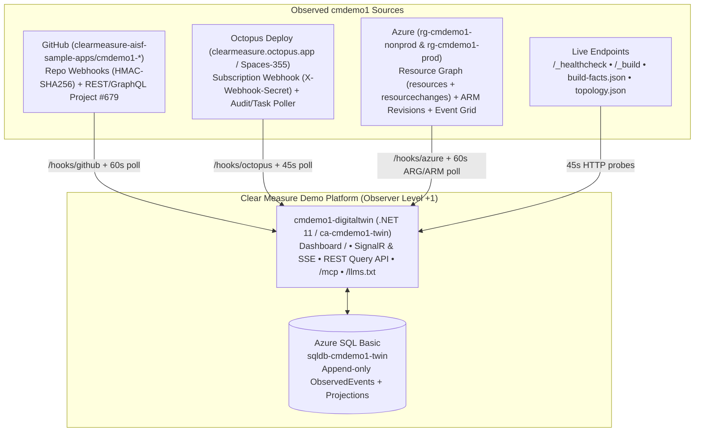
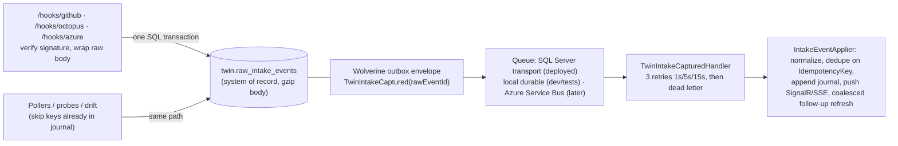

# cmdemo1-digitaltwin

Platform-level DevOps Digital Twin of the `cmdemo1` environment (`clearmeasure-aisf-sample-apps`), built on **.NET 11**, ASP.NET Core Minimal APIs, EF Core (Azure SQL), **Wolverine** (durable intake queue with transactional outbox), SignalR / Server-Sent Events, and the official **Model Context Protocol (MCP)** C# SDK.

The twin sits **one level above `cmdemo1`**: it observes GitHub, Octopus Deploy (`Spaces-355`), Azure (`rg-cmdemo1-nonprod` and `rg-cmdemo1-prod`), and live service endpoints without becoming one of `cmdemo1`'s deployables.

---

## Architecture



### Solution Layout (Onion Architecture)

Dependencies point inward only; `ArchitectureTests` fails the build if they don't.

| Layer | Project | May reference | Contents |
|---|---|---|---|
| Core | `DigitalTwin.Core` | nothing (BCL only) | Domain model, normalizers, drift/DORA domain services, intake model (`RawIntakeEvent`, `IntakeNormalizer`), all ports (`ITwinStore`, `IIntakePublisher`, `IRawIntakeStore`, sync ports, …) |
| Application | `DigitalTwin.Application` | Core | Use cases: idempotent intake applier, rebuild-from-raw, drift reconciliation, follow-up refresh scheduler, backfill + polling scheduler, query service, DTOs |
| Integration | `DigitalTwin.GitHub` | Core | GitHub REST/GraphQL client (rate budget, ETags), repo/run/board sync, webhook registration |
| Integration | `DigitalTwin.Octopus` | Core | Octopus `Spaces-355` sync and subscription registration |
| Integration | `DigitalTwin.Azure` | Core | Resource Graph / ARM sync, Event Grid check |
| Integration | `DigitalTwin.Probes` | Core | HTTP health probes of cmdemo1 endpoints |
| Integration | `DigitalTwin.Persistence` | Core | EF Core `TwinDbContext` / `EfTwinStore` (SQL Server; SQLite for unit tests) |
| Integration | `DigitalTwin.Messaging` | Core | Wolverine intake: transactional outbox publisher, raw intake store, handler, dead-letter admin, transports |
| Host | `DigitalTwin.Api` | everything | Composition root: webhooks, REST, MCP, SignalR/SSE, dashboard |

### Hierarchy Modeled

1. **Platform** (`Clear Measure Demo Platform`)
2. **System** (`cmdemo1` — anchored to `cmdemo1-system/system.json`)
3. **Pipelines**
   - `app-ui`: Work Orders UI (`cmdemo1-workorders` → `cmdemo1-ui` → Container App `ui`)
   - `app-dashboard`: Health Dashboard (`cmdemo1-dashboard` → `cmdemo1-dashboard` → Static Web App `dashboard`)
   - `system-gitops`: System GitOps & Infra (`cmdemo1-system` → Deployment Stacks + Runbooks)
   - `measurement-scorecard`: Scorecard & Measurement (`cmdemo1-scorecard-space` → `cmdemo1-scorecard-site`)
   - `factory-agentic`: Software Factory & Agents (Project 679 bot flow + retired `aisf`/`fworker`)
   - `twin-observer`: Platform Observer (`cmdemo1-digitaltwin` — sits above `cmdemo1`, not a deployable)
4. **Deployment Stages**: `tdd` (nonprod, auto-deploy, smoke tests), `uat` (nonprod, sign-off), `prod` (prod, sign-off + restore point), `pool` (declared 8 PR slots, not yet provisioned)
5. **Hosting Boundaries**: `cae-cmdemo1-tdd` (hosts `tdd` & `uat`), `cae-cmdemo1-prod-ekdi` (hosts `prod`), `swa-centralus` (Static Web Apps edge), and `cae-cmdemo1-twin` (platform twin boundary)
6. **Workloads / Revisions / Azure Resources**: Container Apps, immutable revisions, replicas, Azure SQL, Key Vaults, Log Analytics, ACR

---

## Domain Vocabulary & Bounded Contexts

All terminology follows Domain-Driven Design across eight bounded contexts (using **platform** terminology consistently):

| Bounded Context | Core Terms | Meaning in This Twin |
|---|---|---|
| **Observation** | `ObservedEvent`, `IdempotencyKey`, `IngestionCursor` | Immutable CloudEvents/CDEvents-style journal entry keyed by `{source}:{sourceEventId}` |
| **Work** | `WorkItemSnapshot`, `WorkBoardSummary` | GitHub Project #679 issue + status column (`Todo` → `Done`), split into `bot` vs `team` |
| **Source & Change** | `RepositorySnapshot`, `SourceChangeSnapshot` | GitHub `cmdemo1-*` repositories, commits, branches, and PRs (`open`/`closed`/`merged`) |
| **Build & Artifact** | `PipelineRunSnapshot`, `ArtifactPackageSnapshot` | GitHub Actions workflow runs, ACR container images, Octopus packages, release deployments |
| **Release & Delivery** | `ReleaseSnapshot`, `DeliveryExecutionSnapshot`, `RunbookExecutionSnapshot`, `DeploymentFreezeSnapshot` | Octopus releases (`Default` vs `Pull requests` channel), deployments, manual sign-offs, guided failures, freezes |
| **Runtime & Platform** | `DeploymentStage`, `HostingBoundary`, `EnvironmentInstance`, `WorkloadRevisionSnapshot`, `AzureResourceSnapshot` | Splits logical promotion stage (`tdd`/`uat`/`prod`) from hosting boundary (`cae-*`) and live revision/resource state |
| **Reliability & Drift** | `HealthProbeSnapshot`, `DriftFinding` | Live endpoint probes + deterministic comparison of `cmdemo1-system` desired state vs observed Azure/Octopus state |
| **Measurement** | `DoraMetricsSnapshot` | Five DORA metrics: Deployment Frequency, Change Lead Time, Change Fail Rate (counting guided failures), Failed Deployment Recovery Time, Deployment Rework Rate |

Every twin domain event maps to exact source events (GitHub event + action, Octopus audit category and event group, Azure Event Grid event type), verified against the official docs. The table is in [docs/event-mapping.md](docs/event-mapping.md), along with the source events the twin drops or journals only generically. The same mapping exists in code as `SourceEventCatalog`.

---

## Durable Intake (Guaranteed Event Capture)

Every occurrence, from webhooks and from backstop pollers alike, is durably captured before it is acknowledged, then applied to the model by a separate handler:



- **Ack after commit**: the webhook returns `200` only after the raw row and the Wolverine envelope are committed together; any failure returns `503` so GitHub/Octopus/Event Grid redeliver. Signature/secret headers are never persisted.
- **Idempotent processing**: the handler dedupes on the event's idempotency key, so redeliveries, replays and webhook/poll overlap are harmless.
- **Failures**: 3 retries with backoff (1s, 5s, 15s), then the message is dead-lettered (Wolverine dead-letter table) and the raw row is marked. Replay via `POST /api/admin/deadletters/replay`.
- **Event-sourced read models**: pollers are event producers only. Every current-state read model (repositories, PRs, workflow runs, artifacts/RCs, work items, Octopus releases, deployments and runbooks, freezes, desired GitOps config, environments, workloads, Azure resources, health probes, drift, webhook statuses) changes only when a `twin.state.observed` event is applied: one per changed entity, or one per scope for complete sets. A content hash that ignores volatile fields (timestamps, probe latency) means unchanged state produces no events. The latest observation wins by observation time.
- **Rebuild**: `POST /api/admin/rebuild` (add `?wait=false` and poll `/api/admin/rebuild/status`) clears the journal and **all** read models and replays every processed raw row. It reports before/after fingerprints of every read model (`readModelsIdentical`) and of the journal (`identical`). Before clearing anything, it folds every raw state observation in memory and compares entity keys with the live read models. If the raw store cannot reproduce a live row, it refuses (`aborted`) and leaves everything untouched; `?force=true` overrides that. `GET /api/admin/rebuild/preflight` reports the same comparison without rebuilding. Live intake pauses while it runs; events that arrive meanwhile are deferred, never dead-lettered. Because that pause matters on the 5 DTU database, CI verifies it only when the workflow is run manually with `verify_rebuild=true`. That run does two passes: the first must reproduce identical read models (the journal may be re-normalized after a mapping change), and the second must be identical everywhere.
- **Retention and archive**: once a day, whole UTC days of processed raw events older than `Twin:Retention:Days` (30) are written as one gzip JSON-lines file per day (`raw/yyyy/MM/yyyy-MM-dd.jsonl.gz`). They go to a private, cool-tier Blob container in `rg-cmdemo1-nonprod`, are read back and checked, and only then deleted from SQL. Unprocessed and dead-lettered rows stay in SQL. Rebuild and preflight replay the archive first and then SQL, so the full history is preserved while the Basic database stays small. `POST /api/admin/retention/run[?olderThanDays=]` runs it on demand; `GET /api/admin/storage` shows database usage, raw counts and archive days. Locally and in tests the archive is a directory (`Twin:Archive:Provider=FileSystem`).
- **Journal size**: source payloads over 4 KB are replaced in the journal by a stub with their size and SHA-256. The raw intake table keeps the original, compressed. State observations keep their payload, because read models and time travel are folded from it. `POST /api/admin/backfill` re-polls all sources. Ingestion cursors are operational telemetry and are not projected.
- **Visibility**: queue depth (captured but not yet applied), oldest pending age and dead-letter count appear on `/api/twin/summary` (`intakeQueue`), `/api/intake/status`, the dashboard "Intake" pill, and the MCP `get_intake_queue` tool.
- **Transport is configuration** (`Twin:Messaging:Transport`): `LocalDurable` (in-process durable queue backed by the SQL message store), `SqlServer` (queue table in `sqldb-cmdemo1-twin`, used by the deployed twin), `AzureServiceBus` (queue `twin-intake` on `sb-cmdemo1-twin` with managed identity; `infra/servicebus.bicep`, enabled with `deployServiceBus=true` once `Microsoft.ServiceBus` is registered).
- **Processor role**: `Twin:Messaging:ProcessorEnabled=false` turns a host into intake-only (queue transports). The deployed twin runs both roles in one container app; see `docs/decisions.md` (ADR-012).

## How Ingestion Works (Hooks + Reconciliation Polls)

1. **Startup Backfill**: On startup (and via `POST /api/admin/backfill`), `BackfillCoordinator` hydrates desired state (`cmdemo1-system/system.json`, `environments/*/versions.json`, `status/*`), GitHub repos/PRs/runs/Project #679 board, Octopus `Spaces-355`, Azure Resource Graph + ARM revisions, and live HTTP probes, then evaluates drift.
2. **GitHub (Rate-Budgeted <= 1,500 REST calls/hr)**:
   - **Webhook** `POST /hooks/github` verifies `X-Hub-Signature-256` (HMAC-SHA256 with `WEBHOOK_SECRET`) and durably captures the raw delivery; the processor normalizes `push`, `pull_request`, `workflow_run`, `workflow_job`, `check_run`, `issues`, `release`, `deployment`, `package`, etc., streams via SignalR/SSE, and schedules a coalesced single-repo refresh.
   - **Conditional & Batched Reconciliation**: Full backfill once at startup; incremental repo/workflow runs reconciliation every **10 minutes** using `If-None-Match` ETags (`304 Not Modified` = 0 quota), aliased GraphQL repo batching, and zero-quota `raw.githubusercontent.com` reads for `cmdemo1-system`; Project #679 GraphQL board check every **5 minutes**. Tracks `X-RateLimit-Remaining`, enters `backoff` below 1,000, pauses polling below 500, and exposes `gitHubQuota` on `/api/twin/summary`.
3. **Octopus Deploy (`Spaces-355`)**:
   - **Webhook** `POST /hooks/octopus` verifies `X-Webhook-Secret` and durably captures all event categories from the `cmdemo1-digitaltwin` subscription.
   - **Reconciliation Poller** (every 45s) syncs `/api/events`, releases, deployments, tasks, interruptions, runbooks, and deployment freezes.
4. **Azure & Live Probes**:
   - **Webhook** `POST /hooks/azure` handles Event Grid validation handshakes (`SubscriptionValidationEvent`) and `ResourceWrite/Delete/Action` events (activated automatically when `Microsoft.EventGrid` is registered on the subscription).
   - **Reconciliation Poller** (every 60s) queries Azure Resource Graph (`resources` and `resourcechanges` 14-day history), ARM Container Apps & Revisions, Deployment Stacks, Resource Health, and ACR tags.
   - **Health Prober** (every 45s) checks `/_healthcheck`, `/_build`, and `/build-facts.json` across `tdd`, `uat`, and `prod`.

---

## Querying the Twin (REST API, MCP, and `llms.txt`)

- **Dashboard**: `GET /` (public read, live animated swim-lane flow, SignalR + SSE updates)
- **AI Discovery**: `GET /llms.txt`
- **Public Summary / Graph**: `GET /api/twin/summary`, `GET /api/twin/graph`

### Protected Query API (`X-Twin-Key: <TWIN_API_KEY>`)

- `GET /api/events?since=&until=&source=&pipeline=&stage=&eventType=&limit=`
- `GET /api/state-at?asOf=<ISO-8601>`: time travel (see below)
- `GET /api/change-chains?q=<issue|pr|sha|version|release>&limit=&asOf=`: change chains (see below)
- `GET /api/pipelines` and `GET /api/pipelines/{id}`
- `GET /api/environments/{env}` (`tdd`, `uat`, `prod`, `pool`)
- `GET /api/drift?includeResolved=false`
- `GET /api/workitems?column=&worker=&limit=`
- `GET /api/deployments?stage=&deployable=&limit=`
- `GET /api/metrics?windowDays=7&stage=prod`
- `GET /api/explain?q=<issue|pr|version|sha|task>`
- `GET /api/intake` (also public read at `GET /api/intake/status`)
- `GET /api/admin/deadletters` and `POST /api/admin/deadletters/replay` (optional body `{"ids":[...]}`)
- `POST /api/admin/rebuild[?wait=false]`, `GET /api/admin/rebuild/status`
- `POST /api/admin/backfill` and `POST /api/admin/register-hooks`

### MCP Server (Streamable HTTP at `/mcp`)

Pass header `X-Twin-Key: <TWIN_API_KEY>`:

- `get_summary`
- `get_change_chain` (by issue, PR, commit, release or version)
- `get_state_at` (time travel)
- `query_events`
- `get_environment`
- `get_drift`
- `get_pipeline`
- `explain_item`
- `get_intake_queue`

Read tools accept an optional `asOf`.

### Change Chains

A change chain follows one change end to end: work item, branch/PR, CI build, release candidate (package), Octopus release, then deployments to tdd, uat and prod. Each stage has a status (pending, running, waiting, succeeded, failed, skipped), timings, attempts and failed attempts. Each chain has an outcome (in flight, waiting, failed, delivered), the failed stage, lead time (commit to prod) and cycle time (work item to prod).

- **Linking**: a chain is anchored on a release candidate, meaning a pipeline's versioned build or Octopus release. The build, package, release and deployments share that version.
  - The PR is the one whose merge commit is the build's commit, or whose head branch built the RC (cmdemo1 builds RCs from PR branches before merge).
  - The work item is the PR's linked issue, else the issue number in the branch name, else the item whose RC version matches.
  - Open PRs without an RC yet form chains of their own.
- **Correlation**: chains carry the journal's correlation keys (`sha:<commit>`, `pr:<repo>#<n>`, Octopus release, deployment and task ids). `GET /api/change-chains?q=` returns the matching chains plus the journal events of the best match.
- **Query**: `q` accepts an issue or PR number, a commit SHA prefix, a version, an Octopus release, deployment or task id, or a chain id such as `ui@2.4.2664`. Omit it for the most recent chains. `asOf` works here too.
- **Dashboard**: the change-chains panel shows up to six recent changes as animated paths with stage durations. Failed stages are red, retried stages have a red dot, and the running stage pulses. Click a row for the stage details.

### Time Travel (`asOf`)

Every read endpoint (summary, graph, dashboard state, pipelines, environments, drift, work items, deployments, metrics, explain) and every MCP read tool accepts `asOf=<ISO-8601>`. The twin folds the journal's `twin.state.observed` events up to that instant into an in-memory read model, using the same latest-wins and replace-set rules as the live projection. `asOf` just before now is therefore identical to the live tables, and a test enforces that. `GET /api/state-at?asOf=` and the MCP tool `get_state_at` give the compact answer: the version deployed to each environment, the Azure resources that existed, the board columns and active drift at that instant. On the dashboard, the **time travel** strip has a slider covering the state history, a replay button and a LIVE button; realtime updates pause while you view the past. State history starts at the first state observation, which is the event-sourcing baseline on first start.

---

## Local Development & Verification (no Azure needed)

Prerequisites: .NET 11 SDK and Docker. No Azure, GitHub or Octopus credentials are required.

```bash
# Build and run every test. Integration tests start SQL Server via Testcontainers
# and wait for Wolverine processing with tracked sessions.
dotnet test cmdemo1-digitaltwin.sln --configuration Release
```

To use an existing SQL Server instead of Testcontainers, set `TWIN_TEST_SQLSERVER` to a server connection string.

Run the twin locally against SQL Server in Docker:

```bash
docker compose up -d sqlserver
export ConnectionStrings__TwinDb='Server=localhost,1433;Database=twin_local;User Id=sa;Password=LocalDev_Tw1n!Only;TrustServerCertificate=True'
export TWIN_API_KEY=local-key WEBHOOK_SECRET=local-secret
export Twin__EnableBackgroundWorkers=false     # no pollers without credentials
export Twin__Messaging__Transport=LocalDurable # or SqlServer, like the deployed twin
dotnet run --project src/DigitalTwin.Api      # dashboard on the printed URL

# Send a signed test webhook, then watch it get captured and processed
BODY='{"zen":"local","repository":{"name":"cmdemo1-digitaltwin"}}'
SIG=$(printf '%s' "$BODY" | openssl dgst -sha256 -hmac local-secret -r | cut -d' ' -f1)
curl -X POST http://localhost:5000/hooks/github -H 'X-GitHub-Event: ping' -H 'X-GitHub-Delivery: local-1' \
  -H "X-Hub-Signature-256: sha256=$SIG" -H 'Content-Type: application/json' -d "$BODY"
curl http://localhost:5000/api/intake/status
```

Optional Service Bus emulator (for future transport tests; CI does not use it):

```bash
docker compose --profile servicebus up -d
export Twin__Messaging__Transport=AzureServiceBus
export Twin__Messaging__ServiceBusConnectionString='Endpoint=sb://localhost;SharedAccessKeyName=RootManageSharedAccessKey;SharedAccessKey=SAS_KEY_VALUE;UseDevelopmentEmulator=true;'
```

Architecture & infrastructure trade-offs are documented in [`docs/decisions.md`](docs/decisions.md).
