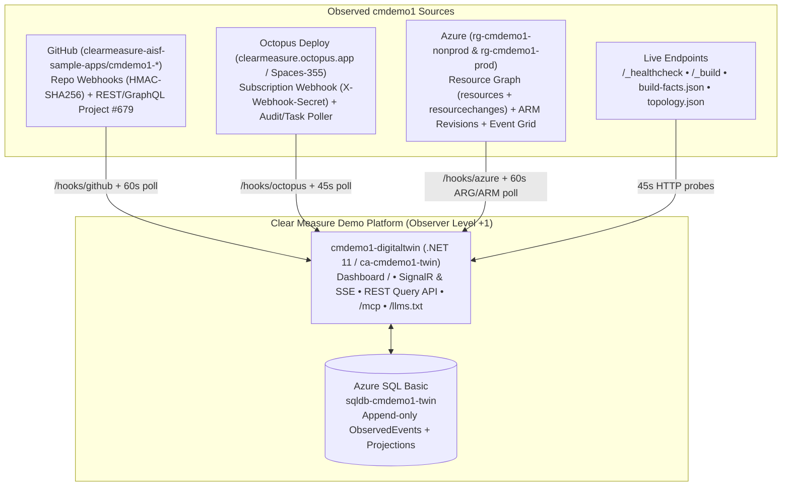

# cmdemo1-digitaltwin

Platform-level DevOps Digital Twin of the `cmdemo1` environment (`clearmeasure-aisf-sample-apps`), built on **.NET 11**, ASP.NET Core Minimal APIs, EF Core (Azure SQL / SQLite), SignalR / Server-Sent Events, and the official **Model Context Protocol (MCP)** C# SDK.

The twin sits **one level above `cmdemo1`**: it observes GitHub, Octopus Deploy (`Spaces-355`), Azure (`rg-cmdemo1-nonprod` and `rg-cmdemo1-prod`), and live service endpoints without becoming one of `cmdemo1`'s deployables.

---

## Architecture



### Hierarchy Modeled

1. **Platform** (`Clear Measure Demo Platform`)
2. **System** (`cmdemo1` — anchored to `cmdemo1-system/system.json`)
3. **Pipelines**
   - `app-ui`: Work Orders UI (`cmdemo1-workorders` → `cmdemo1-ui` → Container App `ui`)
   - `app-dashboard`: Health Dashboard (`cmdemo1-dashboard` → `cmdemo1-dashboard` → Static Web App `dashboard`)
   - `system-gitops`: System GitOps & Infra (`cmdemo1-system` → Deployment Stacks + Runbooks)
   - `measurement-scorecard`: Scorecard & Measurement (`cmdemo1-scorecard-space` → `cmdemo1-scorecard-site`)
   - `factory-agentic`: Software Factory & Agents (Project 679 bot flow + retired `aisf`/`fworker`)
   - `twin-observer`: Platform Observer (`cmdemo1-digitaltwin` — sits above `cmdemo1`, not a deployable)
4. **Deployment Stages**: `tdd` (nonprod, auto-deploy, smoke tests), `uat` (nonprod, sign-off), `prod` (prod, sign-off + restore point), `pool` (declared 8 PR slots, not yet provisioned)
5. **Hosting Boundaries**: `cae-cmdemo1-tdd` (hosts `tdd` & `uat`), `cae-cmdemo1-prod-ekdi` (hosts `prod`), `swa-centralus` (Static Web Apps edge), and `cae-cmdemo1-twin` (platform twin boundary)
6. **Workloads / Revisions / Azure Resources**: Container Apps, immutable revisions, replicas, Azure SQL, Key Vaults, Log Analytics, ACR

---

## Domain Vocabulary & Bounded Contexts

All terminology follows Domain-Driven Design across eight bounded contexts (using **platform** terminology consistently):

| Bounded Context | Core Terms | Meaning in This Twin |
|---|---|---|
| **Observation** | `ObservedEvent`, `IdempotencyKey`, `IngestionCursor` | Immutable CloudEvents/CDEvents-style journal entry keyed by `{source}:{sourceEventId}` |
| **Work** | `WorkItemSnapshot`, `WorkBoardSummary` | GitHub Project #679 issue + status column (`Todo` → `Done`), split into `bot` vs `team` |
| **Source & Change** | `RepositorySnapshot`, `SourceChangeSnapshot` | GitHub `cmdemo1-*` repositories, commits, branches, and PRs (`open`/`closed`/`merged`) |
| **Build & Artifact** | `PipelineRunSnapshot`, `ArtifactPackageSnapshot` | GitHub Actions workflow runs, ACR container images, Octopus packages, release deployments |
| **Release & Delivery** | `ReleaseSnapshot`, `DeliveryExecutionSnapshot`, `RunbookExecutionSnapshot`, `DeploymentFreezeSnapshot` | Octopus releases (`Default` vs `Pull requests` channel), deployments, manual sign-offs, guided failures, freezes |
| **Runtime & Platform** | `DeploymentStage`, `HostingBoundary`, `EnvironmentInstance`, `WorkloadRevisionSnapshot`, `AzureResourceSnapshot` | Splits logical promotion stage (`tdd`/`uat`/`prod`) from hosting boundary (`cae-*`) and live revision/resource state |
| **Reliability & Drift** | `HealthProbeSnapshot`, `DriftFinding` | Live endpoint probes + deterministic comparison of `cmdemo1-system` desired state vs observed Azure/Octopus state |
| **Measurement** | `DoraMetricsSnapshot` | Five DORA metrics: Deployment Frequency, Change Lead Time, Change Fail Rate (counting guided failures), Failed Deployment Recovery Time, Deployment Rework Rate |

---

## How Ingestion Works (Hooks + Reconciliation Polls)

1. **Startup Backfill & Full Rebuild**: On startup (and via `POST /api/admin/rebuild`), `BackfillCoordinator` hydrates desired state (`cmdemo1-system/system.json`, `environments/*/versions.json`, `status/*`), GitHub repos/PRs/runs/Project #679 board, Octopus `Spaces-355`, Azure Resource Graph + ARM revisions, and live HTTP probes, then evaluates drift.
2. **GitHub (Rate-Budgeted <= 1,500 REST calls/hr)**:
   - **Webhook** `POST /hooks/github` verifies `X-Hub-Signature-256` (HMAC-SHA256 with `WEBHOOK_SECRET`), normalizes `push`, `pull_request`, `workflow_run`, `workflow_job`, `check_run`, `issues`, `release`, `deployment`, `package`, etc., streams via SignalR/SSE, and triggers a 15s-coalesced single-repo refresh.
   - **Conditional & Batched Reconciliation**: Full backfill once at startup; incremental repo/workflow runs reconciliation every **10 minutes** using `If-None-Match` ETags (`304 Not Modified` = 0 quota), aliased GraphQL repo batching, and zero-quota `raw.githubusercontent.com` reads for `cmdemo1-system`; Project #679 GraphQL board check every **5 minutes**. Tracks `X-RateLimit-Remaining`, enters `backoff` below 1,000, pauses polling below 500, and exposes `gitHubQuota` on `/api/twin/summary`.
3. **Octopus Deploy (`Spaces-355`)**:
   - **Webhook** `POST /hooks/octopus` verifies `X-Webhook-Secret` and ingests all event categories from the `cmdemo1-digitaltwin` subscription.
   - **Reconciliation Poller** (every 45s) syncs `/api/events`, releases, deployments, tasks, interruptions, runbooks, and deployment freezes.
4. **Azure & Live Probes**:
   - **Webhook** `POST /hooks/azure` handles Event Grid validation handshakes (`SubscriptionValidationEvent`) and `ResourceWrite/Delete/Action` events (activated automatically when `Microsoft.EventGrid` is registered on the subscription).
   - **Reconciliation Poller** (every 60s) queries Azure Resource Graph (`resources` and `resourcechanges` 14-day history), ARM Container Apps & Revisions, Deployment Stacks, Resource Health, and ACR tags.
   - **Health Prober** (every 45s) checks `/_healthcheck`, `/_build`, and `/build-facts.json` across `tdd`, `uat`, and `prod`.

---

## Querying the Twin (REST API, MCP, and `llms.txt`)

- **Dashboard**: `GET /` (public read, live animated swim-lane flow, SignalR + SSE updates)
- **AI Discovery**: `GET /llms.txt`
- **Public Summary / Graph**: `GET /api/twin/summary`, `GET /api/twin/graph`

### Protected Query API (`X-Twin-Key: <TWIN_API_KEY>`)

- `GET /api/events?since=&source=&pipeline=&stage=&eventType=&limit=`
- `GET /api/pipelines` and `GET /api/pipelines/{id}`
- `GET /api/environments/{env}` (`tdd`, `uat`, `prod`, `pool`)
- `GET /api/drift?includeResolved=false`
- `GET /api/workitems?column=&worker=&limit=`
- `GET /api/deployments?stage=&deployable=&limit=`
- `GET /api/metrics?windowDays=7&stage=prod`
- `GET /api/explain?q=<issue|pr|version|sha|task>`
- `POST /api/admin/rebuild` and `POST /api/admin/register-hooks`

### MCP Server (Streamable HTTP at `/mcp`)

Pass header `X-Twin-Key: <TWIN_API_KEY>`:

- `get_summary`
- `query_events`
- `get_environment`
- `get_drift`
- `get_pipeline`
- `explain_item`

---

## Local Development & Verification

```bash
dotnet restore cmdemo1-digitaltwin.sln
dotnet build cmdemo1-digitaltwin.sln --configuration Release
dotnet test cmdemo1-digitaltwin.sln --configuration Release
```

Architecture & infrastructure trade-offs are documented in [`docs/decisions.md`](docs/decisions.md).
